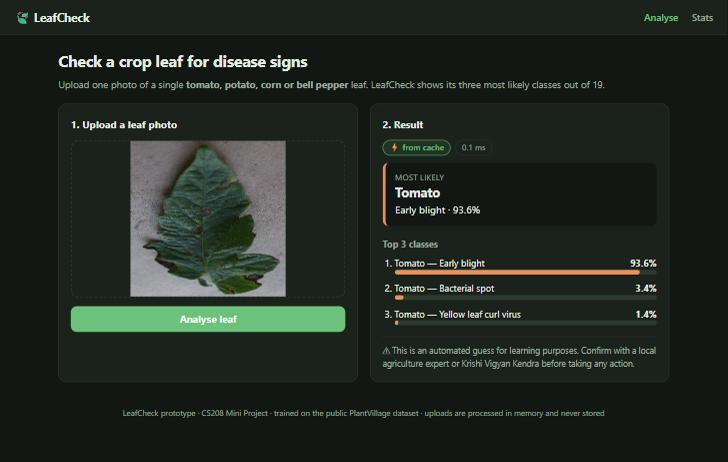
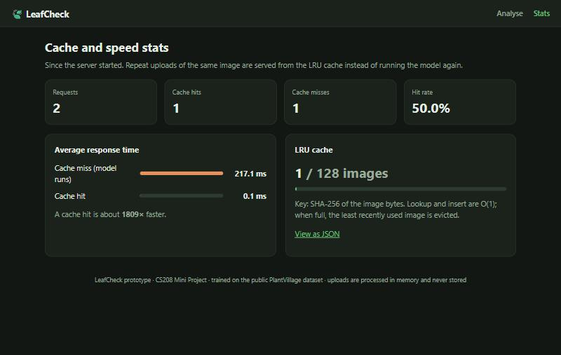

# LeafCheck: crop leaf disease detection prototype

CS208 Mini Project (End Semester hackathon), Sardar Patel Institute of Technology, CSE, Sem V, AY 2026-27.
Group 32: Sanskruti Mahabal, Vrushabh Pokharkar, Adwait Rane.

LeafCheck is a small web app. You upload one photo of a single crop leaf, and it shows the
three most likely diseases (or "healthy") with confidence scores. If the model is not confident
it says **"Not sure, please consult an agriculture expert"** instead of guessing. If you upload
the same image again, the answer comes back in a few milliseconds from an LRU cache.

> This is an automated guess for learning purposes. Confirm with a local agriculture expert or
> Krishi Vigyan Kendra before taking any action. LeafCheck gives no treatment advice.

## 1. Problem and users

- **Problem:** spotting leaf diseases early is hard without an expert nearby. A quick first
  check from a photo can tell a farmer or student which disease *might* be present and that it
  is worth asking an expert.
- **Users:** agriculture students, extension workers and farmers who want a first indication
  before contacting an expert.
- **Scope:** single-leaf photos of 4 crops and 19 classes (below). No treatment advice, no
  field photos, no accounts, no cloud deployment.

| Crop | Classes |
| --- | --- |
| Tomato (10) | Bacterial spot, Early blight, Late blight, Leaf mold, Septoria leaf spot, Spider mites, Target spot, Yellow leaf curl virus, Mosaic virus, Healthy |
| Corn / maize (4) | Cercospora (gray) leaf spot, Common rust, Northern leaf blight, Healthy |
| Potato (3) | Early blight, Late blight, Healthy |
| Bell pepper (2) | Bacterial spot, Healthy |

## 2. Features

- Upload a JPG/PNG (drag and drop or browse), max 5 MB.
- Most likely class + top 3 with confidence bars.
- "Not sure" result when top confidence is below **0.60**.
- **From cache** badge and response time on every result.
- `/stats` page: requests, hits, misses, hit rate, average time for hits vs misses, cache fill.
- Disclaimer on every result. Uploaded images are processed in memory and never saved.
- Demo mode: if no trained model is present the app still runs with a fake predictor.

## 3. Screenshots

| Upload and result | Stats |
| --- | --- |
|  |  |

## 4. Architecture and request flow

```
Browser (templates/index.html + static/app.js)
   |  POST /predict  (multipart "image")
   v
app.py  ── routes only ──>  leafcheck/service.py  (LeafCheckService.analyse)
                               1. preprocess.validate_upload   JPG/PNG, <= 5 MB, decodable  -> else 400
                               2. hashing.fingerprint          key = SHA-256(image bytes)
                               3. cache.get(key)               hit  -> return stored result, from_cache = true
                               4. preprocess.to_model_input    miss -> (1, 224, 224, 3) in [-1, 1]
                               5. predictor.predict_proba      MobileNetV2 -> 19 probabilities
                               6. predictor.build_result       heapq top 3 + 0.60 threshold
                               7. cache.put(key, result)       evicts least recently used when full
                               8. stats.record(hit, ms)
```

| File | One job |
| --- | --- |
| `app.py` | Flask routes: `/`, `/predict`, `/stats`, `/health` |
| `leafcheck/config.py` | All settings: threshold, cache size, upload limit, class names, texts |
| `leafcheck/service.py` | The request pipeline above |
| `leafcheck/cache.py` | Hand-written LRU cache (hash map + doubly linked list) |
| `leafcheck/hashing.py` | SHA-256 fingerprint of image bytes |
| `leafcheck/preprocess.py` | Validate upload, resize to 224x224, scale to [-1, 1] |
| `leafcheck/predictor.py` | Load model once, top-k, threshold, readable labels, fake predictor |
| `leafcheck/stats.py` | Hit/miss counters and average response times |
| `notebooks/train.ipynb` | Colab: data loading, split, training, saving |
| `notebooks/evaluate.ipynb` | Colab: metrics, confusion matrix, `reports/results.md` |

## 5. Data structures and complexity

| Part | Data structure / algorithm | Time | Space |
| --- | --- | --- | --- |
| Cache get/put | Hash map + doubly linked list (LRU) | O(1) average | O(capacity) |
| Fingerprint | SHA-256 | O(file size) | O(1) |
| Preprocess | Resize + normalise | O(pixels) | O(pixels) |
| Prediction | Fixed CNN, fixed input size | Constant per image (~300M multiply-adds) | Model ~10 MB |
| Top-k of n classes | Heap (`heapq.nlargest`) | O(n log k) | O(k) |
| Label lookup | List indexed by class id | O(1) | O(n) |
| Stats | Running totals | O(1) per request | O(1) |

**Why the LRU is O(1):** the dict finds a key's node directly; each node points to its previous
and next node, so moving it to the front or removing the oldest node at the back is just a few
pointer changes, no matter how many items are stored. We wrote it by hand (no `OrderedDict` or
`functools.lru_cache`).

**Why hash the content, not the filename:** the same photo renamed is still a hit, and two
different photos both called `leaf.jpg` are not confused.

## 6. Dataset

- **PlantVillage** (colour images), loaded via TensorFlow Datasets `plant_village`
  (fallback: the original GitHub release).
- Only the 19 classes above, **at most 300 images per class** (~5,700 images).
- **Stratified 70 / 15 / 15** train / validation / test split, seed 42.
- Images resized to 224x224 and scaled with MobileNetV2's `preprocess_input`.
- Augmentation on training data only: horizontal flip, small rotation, small brightness change.

Citation: Hughes, D. P., & Salathé, M. (2015). *An open access repository of images on plant
health to enable the development of mobile disease diagnostics.* arXiv:1511.08060.

## 7. Model and training

- **Transfer learning** with **MobileNetV2** (ImageNet weights, `include_top=False`, base frozen).
- Head: GlobalAveragePooling2D → Dropout(0.2) → Dense(19, softmax).
- Adam (lr 1e-3), categorical cross-entropy, up to 10 epochs, EarlyStopping on validation
  loss (patience 3, best weights restored).
- Trained on a free Google Colab T4 GPU. Saved as `model/leafcheck_mobilenetv2.keras` and
  `model/labels.json`.
- **Why MobileNetV2:** small (~3.5M parameters, ~10 MB file) and fast on a laptop CPU
  (~100 ms per image measured on our laptop), still accurate on PlantVillage.

## 8. Results

Full report: [`reports/results.md`](reports/results.md) (generated by `notebooks/evaluate.ipynb`).

| Metric | Result | Target |
| --- | --- | --- |
| Test accuracy (held-out 15 %, 833 images) | **87.9 %** | >= 90 % (missed by 2.1 points) |
| Macro F1 | 0.876 | |
| Classes with F1 < 0.80 | 3: Tomato early blight (0.55), Septoria leaf spot (0.74), bacterial spot (0.76) | flag any |
| "Not sure" rate / accuracy on confident predictions | 15.6 % / **95.6 %** | report both |
| Prediction time, cache miss (laptop CPU) | ~100 ms | < 1 s |
| Prediction time, cache hit | ~0.1 ms | a few ms |

**Top 2 confusions:** Tomato early blight predicted as bacterial spot (9 images) and
Tomato Septoria leaf spot predicted as bacterial spot (6). All three diseases show small dark
spots on a tomato leaf and look alike at 224 × 224. Corn and potato classes are all above 0.89 F1.

**What we tried:** fine-tuning the last 20 MobileNetV2 layers (lr 1e-5) lowered validation
accuracy from 88.8 % to about 87 %, so we kept the frozen-base model. Validation loss was still
falling at epoch 10, so more epochs are the most likely next improvement.


## 9. Install and run

Requires Python 3.10 to 3.13.

```bash
python -m venv .venv
.venv\Scripts\activate          # Windows  (macOS/Linux: source .venv/bin/activate)
pip install -r requirements.txt
flask --app app run
```

Open http://127.0.0.1:5000. Run the tests:

```bash
pytest -q
```

Windows note: if `pip install tensorflow` fails with a "No such file or directory" error,
the folder path is too long. Create the virtual environment in a short path such as
`C:\lcvenv` instead.

To train the model yourself: open `notebooks/train.ipynb` in Google Colab, choose a GPU
runtime, Run all; then run `notebooks/evaluate.ipynb` and unzip the downloaded
`leafcheck_outputs.zip` into the repo root.

## 10. Tests

`pytest -q` runs 50+ tests. All except one use a **fake predictor**, so they run in under a
second without TensorFlow.

| File | Checks |
| --- | --- |
| `test_cache.py` | get after put, LRU eviction order, get refreshes recency, size ≤ capacity, update existing key |
| `test_hashing.py` | same bytes → same key, different bytes → different key |
| `test_preprocess.py` | any size → (1, 224, 224, 3), pixel range, rejects empty / text / oversize / corrupt files |
| `test_predictor_logic.py` | top 3 sorted, threshold → "not_sure", class names, disclaimer always present |
| `test_stats.py` | counts and averages |
| `test_api.py` | valid upload → 200, bad uploads → 400, same image twice → `from_cache: true`, `/stats` updates |
| `test_model_sanity.py` | real model accuracy > 85 % on sample test images (skipped if model missing) |

## 11. Limitations, safety and ethics

- Trained on **lab photos** (single leaf, plain background). Accuracy on real field photos
  will be lower.
- Only 19 classes. A leaf of another crop or disease is forced into the nearest class; the
  0.60 threshold reduces this but does not solve it.
- High confidence is not proof. No severity estimate. Tested only by the team.
- Small subset (≤ 300 per class) and some class imbalance.
- **No treatment advice** anywhere. Every result shows the disclaimer above.
- **Privacy:** uploaded images are processed in memory and never stored; the cache keeps only
  the SHA-256 key and the result.
- **Sustainability:** early, expert-confirmed detection can reduce blanket pesticide spraying.

## 12. Team and who did what

**Group 32**

| Member | UID | Work |
| --- | --- | --- |
| Adwait Rane | 2024800097 | Model: training and evaluation notebooks, `predictor.py`, `preprocess.py`, model sanity test, reports |
| Vrushabh Pokharkar | 2024800093 | App: `cache.py`, `hashing.py`, `stats.py`, `service.py`, `app.py`, templates, API tests |
| Sanskruti Mahabal | 2024800094 | Testing and docs: test review, README, viva notes, demo samples, slides |
| All | | Code reviews, demo rehearsal |

Git workflow: `main` always runs. Every feature was built on its own branch
(`feature/lru-cache`, `feature/hashing`, `feature/preprocess`, `feature/predictor`,
`feature/stats`, `feature/web-ui`, `feature/tests`, `feature/training`, `feature/evaluation`,
`docs/readme`, `feature/model-results`) and merged into `main` through pull requests #1–#4.
The earlier AgriSense prototype is kept on the `archive/agrisense` branch.
