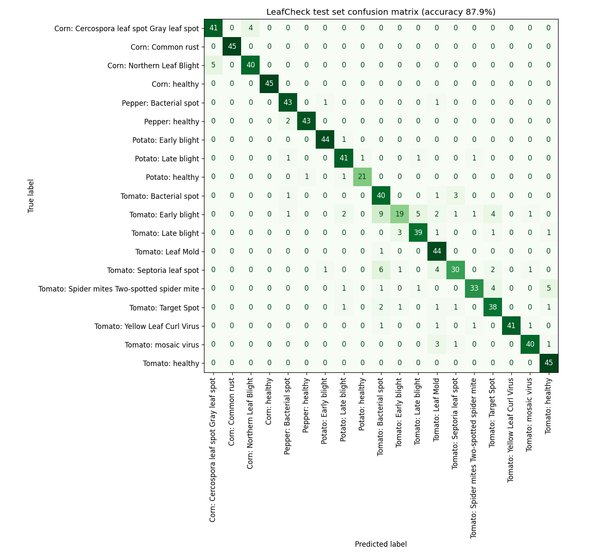
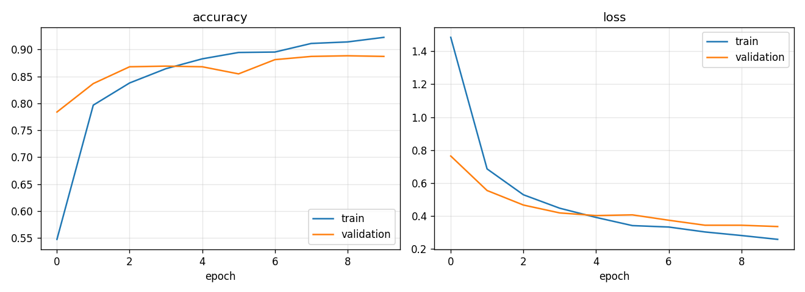

# LeafCheck evaluation results

Held-out **test set**: 833 images (15 % stratified split, seed 42), never used in training.

| Metric | Value | Target |
| --- | --- | --- |
| Test accuracy | **87.88%** | >= 90 % |
| Macro F1 | 0.876 | |
| Classes with F1 < 0.80 | 3 | flag any |
| "Not sure" rate (confidence < 0.6) | 15.61% | report |
| Accuracy on confident predictions | 95.59% | report |
| Epochs trained (early stopping) | 10 | ~10 |
| Best validation accuracy | 88.84% | |
| Prediction time, cache miss (laptop CPU, full request) | ~100 ms | < 1 s |
| Prediction time, cache hit | ~0.1 ms | a few ms |

## Per-class results

| Class | Precision | Recall | F1 | Test images |
| --- | --- | --- | --- | --- |
| Corn: Cercospora leaf spot Gray leaf spot | 0.891 | 0.911 | 0.901 | 45 |
| Corn: Common rust | 1.000 | 1.000 | 1.000 | 45 |
| Corn: Northern Leaf Blight | 0.909 | 0.889 | 0.899 | 45 |
| Corn: healthy | 1.000 | 1.000 | 1.000 | 45 |
| Pepper: Bacterial spot | 0.896 | 0.956 | 0.925 | 45 |
| Pepper: healthy | 0.977 | 0.956 | 0.966 | 45 |
| Potato: Early blight | 0.957 | 0.978 | 0.967 | 45 |
| Potato: Late blight | 0.872 | 0.911 | 0.891 | 45 |
| Potato: healthy | 0.955 | 0.913 | 0.933 | 23 |
| Tomato: Bacterial spot | 0.667 | 0.889 | 0.762 | 45 | ⚠
| Tomato: Early blight | 0.792 | 0.422 | 0.551 | 45 | ⚠
| Tomato: Late blight | 0.848 | 0.867 | 0.857 | 45 |
| Tomato: Leaf Mold | 0.759 | 0.978 | 0.854 | 45 |
| Tomato: Septoria leaf spot | 0.833 | 0.667 | 0.741 | 45 | ⚠
| Tomato: Spider mites Two-spotted spider mite | 0.917 | 0.733 | 0.815 | 45 |
| Tomato: Target Spot | 0.776 | 0.844 | 0.809 | 45 |
| Tomato: Yellow Leaf Curl Virus | 1.000 | 0.911 | 0.953 | 45 |
| Tomato: mosaic virus | 0.930 | 0.889 | 0.909 | 45 |
| Tomato: healthy | 0.849 | 1.000 | 0.918 | 45 |

## Top confusions

1. **Tomato: Early blight** predicted as **Tomato: Bacterial spot** (9 images)
2. **Tomato: Septoria leaf spot** predicted as **Tomato: Bacterial spot** (6 images)

## Caveat

PlantVillage photos are single leaves on plain backgrounds taken in a lab. Accuracy on real
field photos (mixed backgrounds, several leaves, different lighting) will be lower.

## Notes for the viva

- **Below the 90 % target (87.9 %).** Validation loss was still falling at epoch 10
  (0.343 → 0.335), so the frozen-base model was slightly under-trained, not overfitting:
  train accuracy 92.3 % vs validation 88.7 % at the last epoch.
- **Fine-tuning was tried and rejected.** Unfreezing the last 20 MobileNetV2 layers
  (learning rate 1e-5) lowered validation accuracy to 85.8–87.2 %, so we kept the frozen-base
  model. The choice was made on the validation set; the test set was used only once, here.
- **The weak classes are all tomato leaf-spot diseases.** Early blight, Septoria leaf spot and
  bacterial spot all show small dark spots on a tomato leaf, and at 224 × 224 they look alike.
  Early blight has low recall (0.42): it is often called bacterial spot (9 of 45 images).
- **The threshold helps.** 15.6 % of test images get "Not sure". On the remaining 84.4 %,
  accuracy is 95.6 %, so when LeafCheck does name a class it is right far more often.
- **Timing** measured on our laptop CPU through the full request (validate, hash, preprocess,
  predict): cache miss ~100 ms, cache hit ~0.1 ms (about 900× faster). Model load at startup
  takes ~2.5 s, once.
- **Sanity test** (`tests/test_model_sanity.py`): 33 / 38 = 86.8 % on 2 test images per class.
